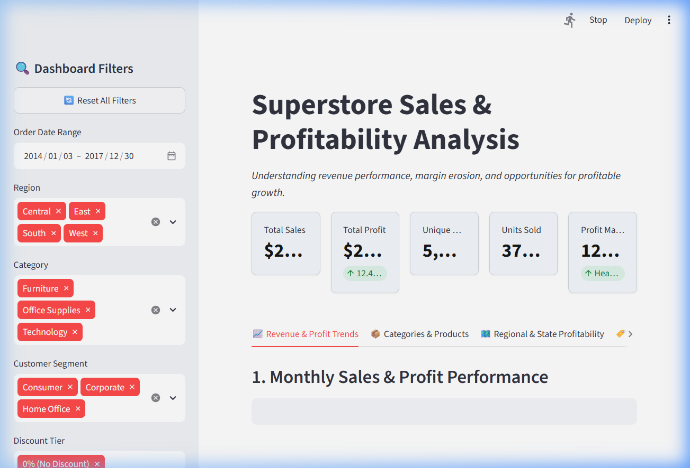
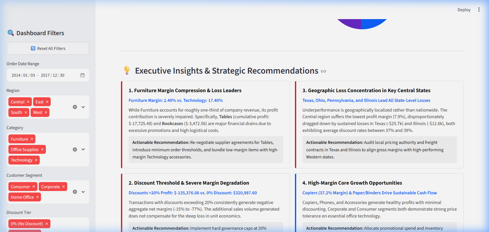

# Superstore Sales & Profitability Analysis Dashboard

An end-to-end business intelligence and data analytics portfolio project demonstrating data inspection, cleaning, SQL analysis with SQLite, and an interactive executive dashboard built with Streamlit and Plotly.

---

## 📌 Executive Summary & Business Problem

The **Sample Superstore** dataset records 9,994 retail transactions across the United States between 2014 and 2017, generating **$2,297,200.86 in total sales** and **$286,397.02 in net profit** (an overall profit margin of **12.47%**).

While top-line revenue demonstrates steady year-over-year expansion, aggregate profitability masks severe financial erosion within specific operational pockets:
- **Furniture Margin Compression**: Generates 32% of total sales but delivers a profit margin of only **2.49%**, dragged down by heavy cumulative losses in **Tables (-$17,725.48)** and **Bookcases (-$3,472.56)**.
- **Discount Margin Collapse**: Transactions with discount rates exceeding **20%** consistently produce negative net margins (-15% to -77%), failing to generate sufficient incremental volume to offset unit margin erosion.
- **Geographic Loss Concentration**: Over **$70,000 in cumulative losses** are concentrated across four states (**Texas, Ohio, Pennsylvania, Illinois**), all exhibiting average discount rates between 32% and 39%.

This project provides business leaders with an interactive decision-support system to diagnose profit drains, evaluate discount sensitivity, and execute targeted profitability interventions.

---

## 🛠️ Technology Stack

| Layer | Technologies |
| :--- | :--- |
| **Data Processing & Analytics** | Python 3.11, Pandas |
| **Relational Database** | SQLite (`sqlite3` built-in module), SQL |
| **Data Visualization** | Plotly Express, Plotly Graph Objects |
| **Web Application** | Streamlit |
| **Testing & CI** | Python `unittest` framework |
| **Version Control & Docs** | Git, Markdown |

---

## 📂 Repository Structure

```text
superstore-profitability-analysis/
├── data/
│   ├── Sample - Superstore.csv      # Raw original dataset (read-only)
│   ├── cleaned_superstore.csv       # Cleaned & feature-engineered dataset
│   └── superstore.db                # SQLite database with indexed tables
├── sql/
│   └── analysis_queries.sql         # 10 production-grade analytical SQL queries
├── src/
│   ├── inspect_data.py              # Robust data inspection & integrity check
│   ├── data_cleaning.py             # Preprocessing & KPI calculations
│   └── load_to_sqlite.py            # SQLite database migration & index creation
├── tests/
│   ├── test_inspect_data.py         # Unit tests for raw data integrity
│   ├── test_pipeline.py             # Integration tests for data cleaning & SQL
│   └── test_dashboard_kpis.py       # Calculation & filter parity tests
├── screenshots/                     # Dashboard captures & diagrams
├── .gitignore                       # Standard Python & OS exclusions
├── requirements.txt                 # Pinned project dependencies
├── app.py                           # Interactive Streamlit dashboard
└── README.md                        # Project documentation
```

---

## 📊 Dataset & Data-Cleaning Methodology

### Dataset Source
- **Origin**: Public Tableau Sample Superstore Dataset.
- **Scope**: 9,994 transaction rows across 21 initial attributes spanning 2014-01-03 through 2017-12-30.
- **Integrity**: 0 missing values, 0 duplicate records.

### Cleaning & Feature Engineering Pipeline (`src/data_cleaning.py`)
1. **Encoding Resilience**: Safe multi-encoding loader (`utf-8` → `windows-1252` fallback) preventing character corruption.
2. **Date Parsing & Temporal Dimensions**: Converted `Order Date` and `Ship Date` to datetime, deriving `Order Year`, `Order Month` (`YYYY-MM`), `Order Month Num`, and `Order Month Name`.
3. **Logistics Audit**: Computed `Shipping Days = Ship Date - Order Date` and verified that no negative transit times exist.
4. **Profit Margin Calculation**: Computed `Profit Margin % = (Profit / Sales) * 100` with zero-division safeguards.
5. **Discount Sensitivity Tiers**: Segmented discounts into 4 standardized analytical brackets:
   - `0% (No Discount)`
   - `1-20% (Low Discount)`
   - `21-40% (Moderate Discount)`
   - `>40% (Deep Discount)`

---

## 📈 Executive KPI Definitions

$$\text{Total Sales} = \sum \text{Sales} = \$2,297,200.86$$

$$\text{Total Profit} = \sum \text{Profit} = \$286,397.02$$

$$\text{Unique Orders} = \text{COUNT}(\text{DISTINCT } \text{Order ID}) = 5,009$$

$$\text{Units Sold} = \sum \text{Quantity} = 37,873$$

$$\text{Overall Profit Margin} = \frac{\sum \text{Profit}}{\sum \text{Sales}} \times 100 = 12.47\%$$

---

## 🗄️ SQL Analysis Highlights (`sql/analysis_queries.sql`)

The repository includes ten structured queries executed directly against SQLite:

1. **Executive KPI Overview**: Aggregates enterprise sales, profit, unique orders, and profit margin.
2. **Category Profitability Breakdown**: Analyzes revenue vs bottom-line margin by product category.
3. **Sub-Category Rankings**: Identifies profit champions (Copiers: $55.6k, Phones: $44.5k) and loss leaders (Tables: -$17.7k).
4. **Regional Operational Performance**: Compares West (14.9% margin), East (13.5%), South (11.9%), and Central (7.9%).
5. **Bottom 10 Loss-Making States**: Audits states where negative profits concentrate alongside high discount rates.
6. **Discount Sensitivity Tiers**: Evaluates profit margin changes across discount brackets.
7. **Monthly & Yearly Seasonality**: Tracks 48-month growth trajectories and Q4 holiday surges.
8. **Customer Segment Performance**: Compares Consumer ($1.16M sales), Corporate ($706k), and Home Office ($430k).
9. **Shipping Mode Transit Time vs. Margin**: Audits Standard Class, Second Class, First Class, and Same Day.
10. **Top 10 Product Loss Leaders**: Details individual SKUs causing the largest absolute financial deficits.

---

## 💡 Key Analytical Findings & Business Recommendations

| # | Observation | Supporting Metric | Business Impact | Actionable Recommendation |
| :---: | :--- | :--- | :--- | :--- |
| **1** | **Furniture Margin Deficit** | Furniture Margin is **2.49%** vs. Technology's **17.40%** | Generates $742k in revenue with virtually zero bottom-line contribution. | Re-negotiate supplier agreements for **Tables** (-$17.7k loss) and bundle with high-margin Technology items. |
| **2** | **Discount Threshold Cliff** | Discounts >20% yield **-$135,376.05** combined net loss | High discounts severely degrade unit economics without sufficient compensatory volume. | Implement a hard governance policy: discounts >20% require regional manager approval. |
| **3** | **Geographic Loss Concentration** | Texas (-$25.7k) & Illinois (-$12.6k) lead state losses | Central region margin is dragged down to **7.92%** due to local discounting (37–39% avg). | Audit local distributor contracts and adjust regional baseline pricing in Texas and Illinois. |
| **4** | **High-Yield Growth Drivers** | Copiers deliver **37.20% margin** ($55.6k profit) | Technology and Office Supplies provide stable, highly scalable cash flows. | Reallocate promotional budget and marketing spend toward high-margin business equipment. |

> **Methodological Note on Causation**: The relationship between discounts and losses is an observed empirical association. In retail environments, discounts frequently co-occur with inventory clearances, end-of-life SKUs, or bulky freight costs. Pricing strategies should be verified via controlled A/B testing before broad policy enforcement.

---

## 🚀 Setup & Installation Guide

### Prerequisites
- Python 3.10+ installed on your system.
- PowerShell or Terminal.

### 1. Clone & Navigate to the Repository
```powershell
cd "c:\Users\biswa\OneDrive\Desktop\sales analysis\superstore-profitability-analysis"
```

### 2. Activate Virtual Environment
```powershell
# Windows PowerShell
.\.venv\Scripts\Activate.ps1
```

### 3. Install Dependencies
```powershell
python -m pip install -r requirements.txt
```

### 4. Execute the End-to-End Pipeline
```powershell
# Step A: Data inspection & validation
python src/inspect_data.py

# Step B: Data cleaning & KPI generation
python src/data_cleaning.py

# Step C: Populate SQLite database with indexes
python src/load_to_sqlite.py

# Step D: Run automated test suite
python -m unittest discover -s tests -v
```

### 5. Launch the Streamlit Dashboard
```powershell
python -m streamlit run app.py
```
*The dashboard will automatically open in your default browser at `http://localhost:8501`.*

---

## 🖼️ Dashboard Preview & Features


*Figure 1: Executive KPI Cards, Sidebar Filters, and Monthly Sales & Profitability Trends.*


*Figure 2: Executive Insights, Category Breakdown, and Strategic Recommendations Matrix.*

The dashboard provides a business intelligence cockpit:
- **Interactive Sidebar**: Filter by Date Range, Region, Category, Customer Segment, and Discount Tier with an instant **Reset Filters** action.
- **Executive Metric Cards**: Dynamic sales, profit, order counts, units, and profit margin cards that reflect filtered states.
- **5 Comprehensive Tabs**:
  1. *Revenue & Profit Trends*: Interactive monthly dual-axis time series and customer segment share.
  2. *Categories & Products*: Revenue vs Profit grouped bars, sub-category ranking with color-coded profit status, and Top 10 Product Loss Leaders.
  3. *Regional & State Profitability*: Regional bar comparisons and Top 10 Loss-Making States.
  4. *Discount Impact & Sensitivity*: Net profit by discount tier and transaction-level scatter plot.
  5. *Detailed Records*: Searchable transaction table with **Export Filtered CSV** capability.
- **Executive Insights Section**: Live-computed metric badges with strategic business context.

---

## 🧪 Automated Testing

The project maintains **14 automated unit and integration tests** in the `tests/` directory:
- `tests/test_inspect_data.py` (6 tests): Validates raw file existence, dimensions, columns, nulls, and duplicate absence.
- `tests/test_pipeline.py` (3 tests): Validates cleaned dataset integrity, SQLite index schema, and SQL query syntax execution.
- `tests/test_dashboard_kpis.py` (5 tests): Validates mathematical parity between Pandas and SQLite, zero-division safeguards, filter slice integrity, and loss leader validation.

Run all tests with:
```powershell
python -m unittest discover -s tests -v
```

---

##  ## Skills Demonstrated

- **Python & Pandas:** Data cleaning, transformation, and validation.
- **SQL & SQLite:** Business queries, aggregations, and profitability analysis.
- **Data Visualization:** Interactive dashboards using Streamlit and Plotly.
- **Business Analysis:** Identifying sales trends, loss-making products, and discount-related profitability patterns.
